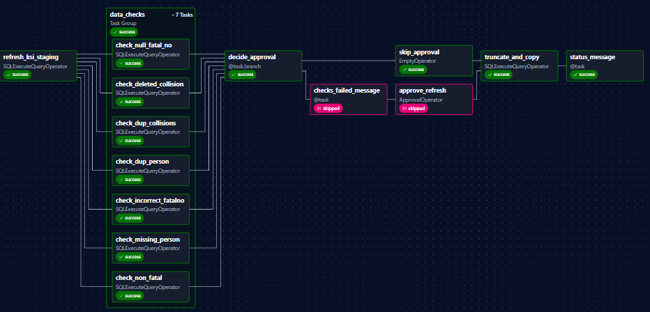

# KSI Open Data Refresh Process

We publish KSI data (Killed or Seriously Injuried) to [Open Data](https://open.toronto.ca/dataset/motor-vehicle-collisions-involving-killed-or-seriously-injured-persons/) on a daily basis. The process includes refreshing the dataset, applying data checks, and ping for human decision when needed. When any data checks fails, an alert will be send to slack and refresh will pause until a human can verify that the discrepancy is either expected or fixed. This dataset only includes data from 2006 to present.

## Published Columns

| Column | Type | Description |
|------|------|-------------|
| collision_id | text | Collision identifier |
| accdate | timestamp | Date and time of the collision |
| stname1 | text | Primary street name |
| stname2 | text | Secondary street name |
| stname3 | text | Tertiary street name | 
| per_inv | integer | Number of persons involved |
| acclass | text | Collision classification |
| accloc | text | Collision location |
| traffictl | text | Traffic control type |
| impactype | text | Initial Impact type |
| visible | text | Environment conditions |
| light | text | Light conditions |
| rdsfcond | text | Road surface condition |
| road_class | text | Road classification |
| failtorem | text | Failure to remain at scene |
| longitude | double precision | Longitude|
| latitude | double precision | Latitude |
| veh_no | smallint | Vehicle number |
| vehtype | text | Vehicle type |
| initdir | text | Initial direction of travel |
| per_no | smallint | Age of Involved Party |
| invage | smallint | Involved person age |
| injury | text | Severity of Injury |
| safequip | text | Safety equipment used |
| drivact | text | 	Apparent Driver Action |
| drivcond | text | Driver condition |
| pedact | text | Pedestrian action |
| pedcond | text | Pedestrian condition |
| manoeuvre | text | Vehicle manoeuver |
| pedtype | text | Pedestrian type |
| cyclistype | text | Cyclist type |
| cycact | text | Cyclist action |
| cyccond | text | Cyclist condition |
| road_user | text | Road user classification |
| fatal_no | smallint | Fatal number of the year |
| wardname | text | Ward name |
| division | varchar | Police division |
| neighbourhood | text | Neighbourhood name |
| aggressive | text | Aggressive driving involved |
| distracted | text | Distracted driving involved |
| cyclist | text | Cyclist involved |
| motorcyclist | text | Motorcyclist involved |
| other_micromobility | text | Other micromobility involved |
| older_adult | text | Older adult involved |
| pedestrian | text | Pedestrian involved |
| red_light | text | Red light running involved |
| school_child | text | School child involved |
| heavy_truck | text | Heavy truck involved |

## Data checks in place

1. Checks for NULL `fatal_no` for fatalities

2. Checks for deleted collisions from previous day

3. Checks for deleted involved person from previous day

4. Checks for duplicated collision records

5. Checks for duplicated collision and involved person

6. Checks for duplicated or skipped fatal_no in a year

7. Checks for fatal_no assigned to non-fatal involved person

All these check might be valid changes that got carried through from verification processes. When check fails, an alert will be send to slack for humans to confirm that these discrepancy is intended, then with `human in the loop` operators, users with permission can approve the pipeline to continue with refreshes and updates.

## When human actions are required

If any of the above data checks failed during the daily refresh, the open data table will not be updated until a human's approval. The slack alert includes information needed to investigate, e.g. `collision_id` with skipped fatal_no, or the `collision_id` of a deleted collision.

These two tables are useful for debugging:

- `open_data.ksi`

The table containing the data last sent to Open Data. When a refresh is paused, this table contains the previously published data. If the failed check was for a deleted collisoin, the deleted collision_id will still appear here.

- `open_data_staging.ksi`

The staging table, refrehsed with the most up-to-date data. The above data checks run against this materialized view. 

Compare the two tables to identify the discrepancy, then decide whether it is expected behaviour or an error that needs dixing.

### When a decision is finalized

- If the change is intentional: 

Click the link in the airflow alert and click `Approve`. This pipeline will continue and update Open Data table.

- If the change is not intentional and requires revised verification: 

Click `Reject`. The Open Data table will not be refreshed. Then fix the upstream issue, and the collision replicator that runs every morning will update the upstream table. Next day's check should then pass. 

## Pipeline

