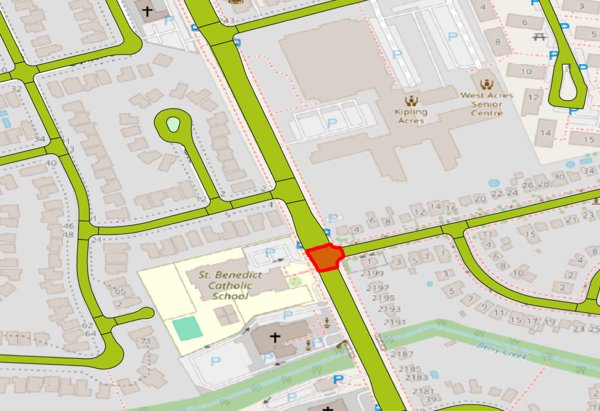
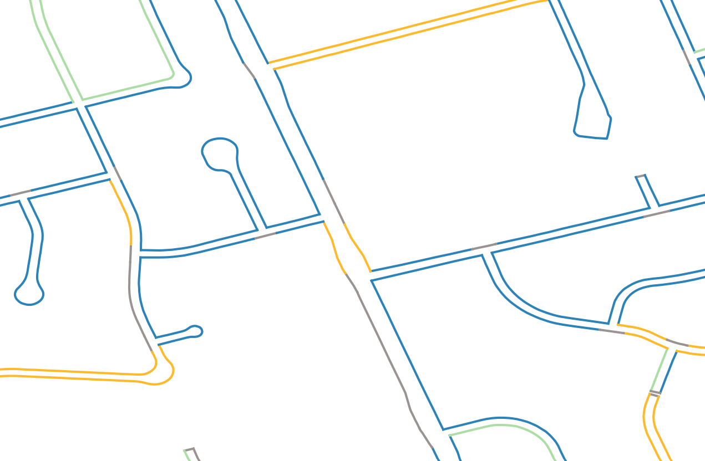
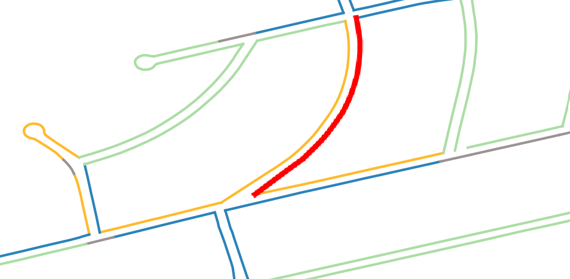
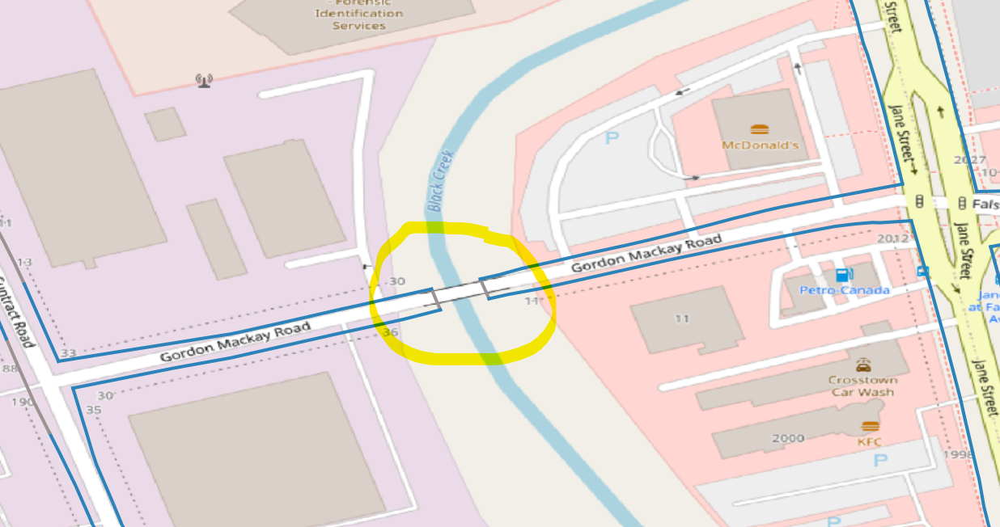
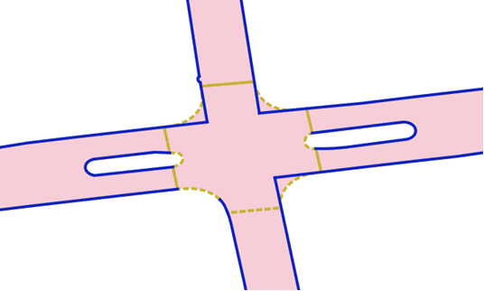
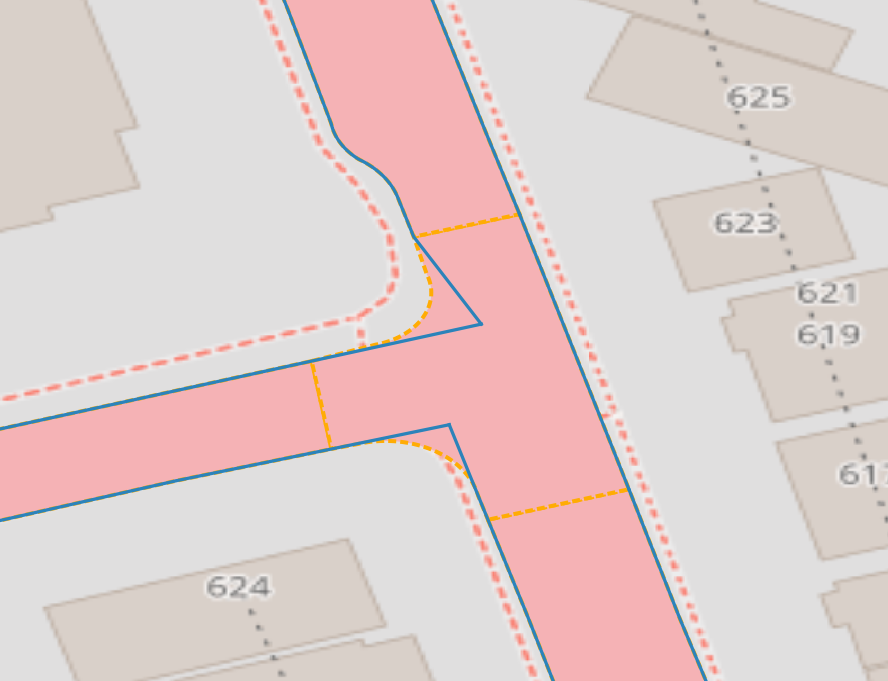
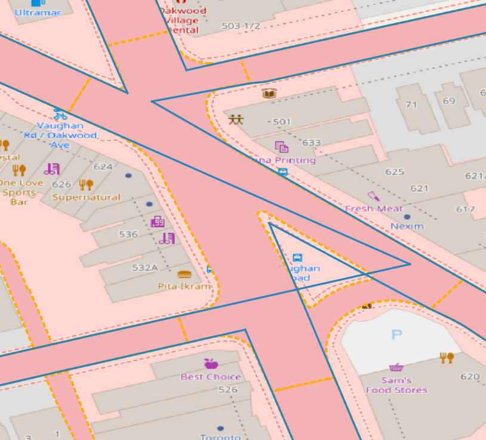
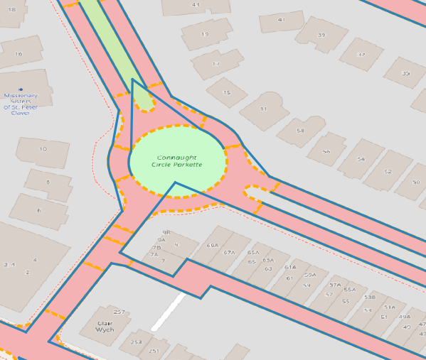

# Curb geometry automation

This project automates the creation of base curb line geometry from edge-of-road polygon data supplied by the Geospaital Competency Centre. The goal is to reduce the manual effort of drawing out each individual curb line across the city. 

The creation of the base curb line geometry is complex, and this automated process will not cover every edge case. Instead, it aims to automate the work as much as possible, recongizing that the generated curb lines will still need human review before it can be accepted. To support that review, every extended curb line is given a confidence level based on a number of parameters. This helps to prioritize the curb line segments that require manual intervention.

The project was identified during the planning of the broader Curbside Management Modernization project. While the larger initiative has not yet received funding, this work is intended to deliver tangible improvements to the existing process in the meantime.

## Steps

For each polygon in `edge_of_roadway`, the script:

1. Dissolve polygons into points, use azimuth to identify "turning points".
2. Use "turning points" to reconstruct distinct lines for each polygon, e.g. a rectangle will have 4 line output
3. Identify "curved" lines by calculating the ratio between line length and point to point distance, large differences will indicate a curver line
4. Find lines that are touching curve line and extend them using the last 10m of the line
5. Find the intersecting point of the extended line and cut the line
6. Merge each extended line with its original line and add back the lines not used in extension
7. Clean result by removing duplicated lines and median lines
8. Score each extended line with a confidence level. See more below. 

## Input

- `gis.edge_of_roadway`: Polygon layer representing the physical area of the City’s street system. Part of the City’s topographic mapping products, the data is collected from high resolution aerial photography. Intersection and road edge are separated into different polygons. Can be access through Toronto's [Open Data Portal](https://open.toronto.ca/dataset/topographic-mapping-edge-of-road/).

## Output

| Column | Description |
|---|---|
| `line_id` | Unique identifier for each line |
| `source` | Where the line originated from: 1) `extended` (an original line plus its extension), 2) `untouched road` (a road edge that did not need extending), 3) `straight intersection edge` (a straight line from an intersection polygon) |
| `confidence_level` | How likely the line is to be correct, from `very low` to `high`. Only `extended` lines are scored, the rest are `NULL` |
| `geom` | The curb line geometry |

### How confidence level is scored

- Only extended lines are evaluated, since they are the only lines where the script creates new geometry. 
- If a line is extended at both ends, it takes the lower of the two levels.

| Level | Rule |
|---|---|
| `very low` | The extended line crosses or overlaps another line in the final layer.  |
| `low` | The line bends by more than 5° near one of its ends, which means the extension direction is not straight (more unreliable), or the angle between the two roads that meet is outside 45–135°* |
| `medium` | The angle between the two roads is 45–135° (Not very right angle)|
| `high` | The angle between the two roads is 75–105°, close to a right angle |

*Angles and bend thresholds were chosen by trial and error, so they can be altered if we decide to run another iteration. The confidence level should still be treat as a guide to what to review first rather than a measure of accuracy. e.g. A medium/low confidence level might be assigned to a curb at a naturally angled intersection, even when the extension is correct. See highlighted red line in the example below.

## Caveats

The edge of polygon layer is generated from a satelitte imagery, and since roads are complex and varies, there are cases where the automation does not work well. This script is designed to handle the most common intersections, such as four way or three way intersections. Complicated intersections, roundabouts, and roads with median do not work well. See some examples below:

### Edge of road polygons that are cut by a river or rail line

Where a river or rail line cuts through the road, the edge of road polygons are not connected, so the curb lines at the break are not joined. This is not really the script is intended to handle, though in the future we could extend and merge those road edges as a clean up before running the script. 

### Median extended to road edge polygon 

When a median extends to the end of the road edge polygon it creates a non-straight edge, the cleaning step does not currently remove these hanging median lines. 

### Roads that change width near an intersection (Bulb-outs) 

Bulb-outs or other edges where the road width changes as it approaches the intersection changes the directionality of the extended curb. 

### More than one intersections merge to one intersection polygon

Complicated intersections like this are often just two intersections polygons merged into one. This does not work well with how the script identifies "curve lines", which affects how it selects which line to make the extension.

### Roundabout

Whether a roundabout works depends on how curved it is, and whether it is curved enough for the script to pick up. Curvature is measured as the ratio of the line's length to the straight line distance between its start and end points.

## Future improvements

### Handle medians that reach into intersections

Medians that extend into an intersection can be identified, removed and rebuild the curb across the gap before running the curb automation process.

### Allow for multiple parameters and select the best result

Several parameters in the script can be tweaked, so it could be run with multiple values and keep the best result. For example:

- The curvature threshold decides where a curb needs to be created
- The 10m stretch used to find the direction of the extended line
- The angle ranges that define each confidence level

### Identify bulb-out

Bulb-out or road edges that have changing road width can be identified and handle separately. 